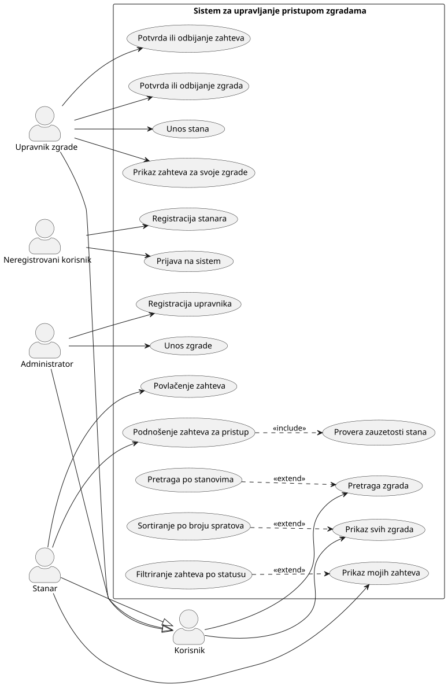
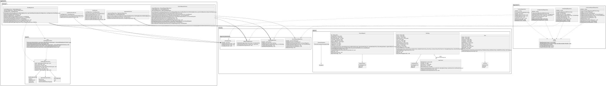

# Sistem za upravljanje pristupom zgradama

Desktop aplikacija (WPF, .NET) za evidenciju stambenih zgrada i stanova i za upravljanje zahtevima stanara za pristup stanovima. Projekat iz predmeta **Specifikacija i modeliranje softvera (SIMS)**.

## Funkcionalnosti

Sistem razlikuje tri uloge korisnika, plus neregistrovanog korisnika:

| Uloga | Mogućnosti |
|---|---|
| **Neregistrovani korisnik** | Registracija kao stanar, prijava na sistem |
| **Svi prijavljeni korisnici** | Prikaz svih zgrada (sa sortiranjem po broju spratova), pretraga zgrada (i po stanovima) |
| **Stanar** | Podnošenje zahteva za pristup stanu (uz proveru zauzetosti stana), prikaz i filtriranje svojih zahteva po statusu, povlačenje zahteva |
| **Upravnik zgrade** | Prikaz zahteva za svoje zgrade, potvrda ili odbijanje zahteva i zgrada, unos stanova |
| **Administrator** | Registracija upravnika, unos zgrada |

Zgrade i zahtevi mogu biti u statusu `PendingApproval`, `Approved` ili `Rejected`. Odbijanje zahteva traži unos razloga.

## Dijagrami

### Dijagram slučajeva korišćenja



### Dijagram klasa

Za pregled u punoj veličini otvorite [class-diagram.svg](diagrams/class-diagram/class-diagram.svg).



Izvorni PlantUML fajlovi su u folderu [`diagrams/`](diagrams/) (`use-case.puml`, `class-diagram.puml`).

## Arhitektura

Aplikacija je podeljena na slojeve, a korisnički interfejs prati **MVVM** obrazac:

```
BuildingManagement/
├── Domain/
│   ├── Models/                 # Entiteti: User, Building, Apartment, AccessRequest, enumi, DomainException
│   └── RepositoryInterfaces/   # Interfejsi repozitorijuma (IUserRepository, IBuildingRepository, ...)
├── Application/
│   ├── UseCases/               # Servisi: Authentication, User, Building, Apartment, AccessRequest
│   └── Search/                 # Kriterijumi i filteri za pretragu zgrada
├── Repositories/               # CSV implementacije repozitorijuma
├── WPF/
│   ├── Views/                  # XAML prozori i ekrani
│   ├── ViewModels/             # ViewModel-i, RelayCommand, navigacija
│   └── Converters/
├── Data/                       # CSV datoteke sa podacima
└── App.xaml(.cs)               # Koren kompozicije: kreira repozitorijume i servise, otvara prijavu
```

- **Domain** ne zavisi ni od jednog drugog sloja; poslovna pravila se proveravaju u modelima i servisima i prijavljuju kroz `DomainException`.
- **Application** sadrži servise (slučajeve korišćenja) koji rade preko interfejsa repozitorijuma.
- **Repositories** čuvaju podatke u CSV datotekama.
- `App.xaml.cs` ubrizgava zavisnosti kroz konstruktore. Glavni prozor gradi meni prema ulozi prijavljenog korisnika.

## Podaci

Podaci se čuvaju u folderu `BuildingManagement/Data/`:

| Datoteka | Sadržaj |
|---|---|
| `users.csv` | Korisnici (JMBG, email, lozinka, ime, prezime, telefon, uloga) |
| `buildings.csv` | Zgrade (šifra, adresa, broj spratova, JMBG upravnika, status) |
| `apartments.csv` | Stanovi (šifra zgrade, broj, opis, broj soba, maksimalan broj stanara) |
| `access_requests.csv` | Zahtevi za pristup (stanar, zgrada, stan, datum, status, razlog odbijanja) |

Aplikacija pri pokretanju sama pronalazi folder `Data/` tako što ga traži naviše od izlaznog foldera.

## Pokretanje

**Preduslovi:** Windows i [.NET 10 SDK](https://dotnet.microsoft.com/download) (projekat cilja `net10.0-windows`).

```bash
dotnet build BuildingManagement.sln
dotnet run --project BuildingManagement
```

Projekat se može otvoriti i u Visual Studio ili Rider preko `BuildingManagement.sln`.

### Test nalozi

| Uloga | Email |
|---|---|
| Administrator | `admin@sims.rs` |
| Upravnik | `upravnik@sims.rs` |
| Stanar | `stanar@sims.rs` |
